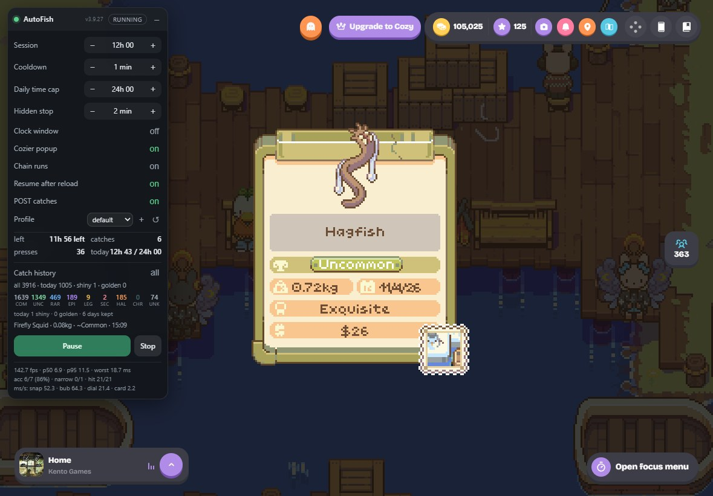
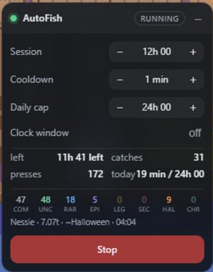
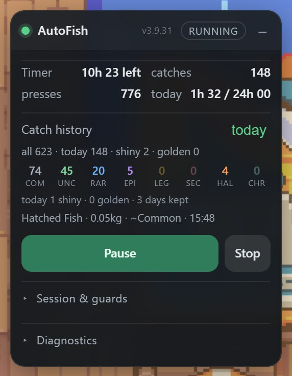

# lofi.town AutoFish

A single-file userscript that plays the lofi.town fishing loop for you: it finds the **CAST!** prompt, reels when the game asks, and presses the spinning dial at the moment the wedge crosses the pin.



No server, no build step, no account. One file in Tampermonkey and a **Start** button.

---

## Install (about two minutes)

**What you need:** Chrome, Edge or Firefox on a desktop, and the game open at <https://app.lofi.town/>. A phone will not work - there is nowhere to install a userscript.

### 1. Add Tampermonkey

Install the [Tampermonkey](https://www.tampermonkey.net/) extension from your browser's extension store, then pin it to the toolbar so you can see it.

### 2. Add the script

Open [autofish.user.js](https://github.com/lowqualityloey/lofitown-autofishing-dist/releases/latest/download/autofish.user.js) - the fixed release URL - and let Tampermonkey install it. If the browser downloads the file instead of showing Tampermonkey's install page, drag it onto the Tampermonkey dashboard or use **Utilities → Import from file**.

That URL always serves the newest build, and an installed copy checks it on Tampermonkey's own schedule: no GitHub account, no reinstall, and the panel's settings survive the update. [`dist/autofish.user.js`](dist/autofish.user.js) in this repository is the same file, for installing a local build - open it and press **Raw**, or paste it into a new Tampermonkey script (**Dashboard → +**, replace the template, **Ctrl+S**). The panel, the bot and the session clock are all inside that one file.

### 3. Open the game and reload

Go to <https://app.lofi.town/> and press **F5** so the script runs on a fresh page. Within a few seconds the AutoFish panel appears in a free corner - usually top-left - keeping clear of the play area.





### 4. Sit on a chair by the water - do this before Start

lofi.town only offers the cast prompt to a **seated** character, so click a chair, bench or stool at the water's edge and wait for the game's own **CAST!** prompt to appear once.


The bot never moves or seats your character: seats are world objects it cannot click meaningfully. If you are not seated it says so on the panel and pauses the clock instead of burning your session.

### 5. Press Start

Press **Start** on the panel. The badge flips to **RUNNING**, `presses` starts climbing, and the rarity strip fills in as fish are caught.

### Nothing happened?

| What you see | What it means |
| :--- | :--- |
| No panel at all | The script is not running on this page. Check the Tampermonkey icon shows a **1** for lofi.town, then reload with F5. |
| Panel says **IDLE** after Start | The game page is hidden, paused, or the character is not seated. Bring the tab to the front. |
| Footer: *clock paused - nothing to bite* | The character is standing. Sit by the water; the session resumes on its own. |
| Two panels stacked | The script got loaded twice (a second copy, or an old console injection). Reload the page. |
| Counters climb, no catches | The rod is out but nothing bites: usually a missed reel prompt. Press Stop, sit again, Start. |

---

## The panel

The panel is two tiers. The surface carries only what a glance needs - the phase chip, the session
clock, catches, presses, today against the cap, the rarity strip and the **Start / Pause** pair -
while **Session & guards** and **Diagnostics** fold away beneath it. A first run therefore needs one
control: press Start.

Where each control lives, top to bottom:

| Where | What lives there |
| :--- | :--- |
| **On the surface** - the short card in the folded screenshot | The phase chip and build, `Timer`, `catches`, `presses`, `today` against the cap, the catch-history block around that strip (all/today toggle, shiny and kept-day lines, last catch) and the **Start / Pause** plus **Stop** pair. Nothing here sets policy; only those two transport buttons act on the run. |
| **Session & guards** - folded | The four steppers (Session, Cooldown, Daily time cap, Stop when hidden), Clock window with its from/to times, Cozier popup, Auto-start next run, Resume after reload, Send catches to CSV, and Profile with its add and reset buttons. Everything decided once, opened once. |
| **Diagnostics** - folded | fps with typical/slow/worst frame time, caught of attempts, rare dials and presses landed, per-second detector work, per-dial and per-card milliseconds; click the block for the raw frame report. Read-only. |

The two screenshots are the same card in its two states: [panel.jpg](docs/images/panel.jpg) with both blocks open, [panel-folded.jpg](docs/images/panel-folded.jpg) with them closed.

- **Session / Cooldown / Daily time cap / Clock window** - how long it fishes, how long it rests after, how much game time it may spend per day, and an optional time-of-day window. Every field can be typed (`90`, `1h 30`, `21:30`) as well as stepped; the cap is **fishing time**, not a fish limit, and 24 h is reachable.
- **Pause / Resume, Stop, Start now** - Pause holds the current session (no cooldown, no lost time); Stop ends it and starts the rest. A daily-cap or clock-window stop does not start a cooldown, and **Start now** skips the self-imposed rest after a confirmation.
- **Stop when hidden / Auto-start next run / Resume after reload / Send catches to CSV / Profile** - page-hidden limit, automatic next session after a rest, opt-in reload resume, opt-in local CSV POST, and which catch history this account uses. The catch-history line has an **all/today** toggle and a confirm-guarded reset for the current profile.
- **Cozier popup** - hides the in-session Cozier upsell. Cosmetic only: a free account still cannot fish in a focus session.
- **Pause in focus sessions** - pauses the run while a focus session runs (solo or together) and resumes when it ends. It draws nothing over the game: the cast prompt is painted into the game's canvas and cannot be removed by a page script.
- **Diagnostics** - fps, typical/slow/worst frame time and per-detector work per second, the same numbers as `__fish.perf()`.
- **Timer / catches / presses / today** - session time remaining, catches this session, dial presses, game time spent today against the cap.
- **Catch history** - all-time and today totals together, lifetime shiny/golden, today's shiny/golden, and how many day buckets are kept (60 max). The strip can show all-time or **today**; **UNK** appears when the card printed no tier and the species is not in the built-in catalogue.
- **Last catch** - species, weight, rarity (a leading `~` means the rarity came from the built-in catalogue because the card printed none), and the local time.
- **acc / perf** - fish attempts caught vs attempts, plus the narrow-dial slice; click the block for `__fish.calibration()` and the full frame report.
- Drag by the header to move it; **-** collapses it to a 48 px pill, click the pill to restore it.

## What it actually does

- **Finds prompts in pixels.** The game merges the CAST!/REEL! prompts and the reel dial into its WebGL renderer canvas, so detection runs from a wrapper around the renderer's `render()` and reads the frame the game just painted; a `requestAnimationFrame` read sees a cleared buffer.
- **Reads without allocating.** The renderer's WebGL buffer is read with `readPixels` into one reused array instead of a fresh `getImageData` copy for every box; the 2D copy remains the fallback. Live 3.9.12 in the owner's tab: **140.5 fps, p95 11.2 ms, one 91 ms long task in ten seconds**; the same tab on 3.9.9 read 106.8 fps with a 250-285 ms stall every second while it waited for a bite.
- **Presses the dial on a timer.** Rotation is fitted by least squares over the last ~200 ms, the crossing is predicted, and a `setTimeout` clicks the dial centre at that moment. Frames re-plan and cancel the timer, and containment takes an already-open window (`inside-now`) rather than waiting almost a full rotation when the pin is past the midpoint.
- **Holds the first press on a hard dial.** On a narrow (<60 deg) or fast (>=300 deg/s) dial, the first press waits up to 2.5 s for a stable spin fit instead of firing on a noisy estimate.
- **Remembers the dial.** The reel widget's circle is saved per canvas size and tried before any search. If the hint is wrong, one whole-surface pass finds the green wedge and recovers the lock - a fresh run no longer needs a prompt to find its first dial.
- **Scores fish, not clicks.** One fish is many presses (the game shows a level bar), so the unit is the *fish attempt*: it opens at the first dial lock and closes at a parsed catch or when the cast prompt returns. A win is only counted when the catch card's text parses to a species.
- **Keeps a ledger.** `localStorage` key `autofish:log:v1:<profile>`: per-species count and best weight, per rarity and per day totals (including that day's shiny/golden), 60 day buckets, and the names of any species the catalogue did not recognise. The profile owns its own daily budget (`autofish:budget:v1:<profile>`), so two accounts in one browser never share a history or a cap. A reset button clears the current profile's history after a confirmation; resetting does not delete the profile itself.
- **Pauses honestly.** A hidden tab pauses the clock, and so does standing up; the session resumes when a prompt comes back and gives up after 30 minutes unseated. The panel's Pause is a separate hold: it does not end the session or start the cooldown.

## How well does it fish?

The current build is measured by its own runs. The latest fresh 3.9.27 session was **145 fish attempts**: **144 caught (99.3%)**, 777/777 presses accepted, **258 dial hits with 0 misses**, and 144 catch cards. The only loss was attempt #5, a 61.7° dial with 6 accepted presses and 3 hits that ended on the cast prompt - not a ghost; the 3.9.26 ghost filter also met two ghost rings in that run and moved past both. The historical 3.9.15 baseline remains useful context: **126/133 attempts (94.7%, Wilson 95% CI 89.5-97.4%)**, 697 presses all accepted (**0 rejected**), 5.53 presses a catch, 254 dials closed, 139.1 fps median with a 12.5 ms p95 frame gap. Its seven losses all scored "cast prompt" - the fish left before the cast landed - and none as a bad dial. Split by dial width, the wide and full dials went **52/52**, the mid band 65/69, and the narrow band **20/27 across three sessions**. A 3.9.19 session then measured the thing that decides a narrow press: prediction error p50 **1.9 deg / 9.6 ms**, p95 **6.1 deg / 31.3 ms**, against a narrow window ~62 ms wide - so the narrow band was never a timing problem. One honest caveat on every press number here: **36% of press verdicts are inferred**, not observed, which the 3.9.19 probe counts for the first time. The 3.9.15 run remains the first one the bot could export attempt by attempt (see `__fish.exportRun()`); before it, the baseline was the 3.8.8 75-minute seated session, **103/112 (92.0%, 85.4-95.7%)**, 602 presses, 5.84 presses a catch, 218 dials closed with 217 hit. Shorter checks since - 7/7, 1/1, 8/8, 43/43 presses accepted - are regression evidence, not estimates.

Per-press timing is scored by whether the game spawned a new triangle (a press it acted on), not by whether the dial closed - only the finishing press can do that. Read `__fish.status().accuracy.pressAcceptRate`.

## Limits

- **The tab must stay visible.** The game freezes its own timers when hidden, and the bot stops stepping. A covered window counts as hidden in both Chrome and Firefox; see [Keeping it running](#keeping-it-running-background-tabs) for the one case that can be fixed. A real overnight run also needs the machine awake.
- **You seat the character.** Nothing else can.
- **The game can still win.** Legendary and secret fish need many presses inside a tight clock; a missed click costs the previous gain and the streak.
- **One tab, one copy.** Loading the script twice mounts two panels.
- It automates an online game, which can break that game's terms. Your call, your risk. Not affiliated with lofi.town.

## Keeping it running (background tabs)

The game draws on `requestAnimationFrame` and keeps its fishing clock in page time, so a page the
browser treats as **hidden** stops fishing whatever the bot does. That is a browser rule, not a
setting in AutoFish:

| What you do | What the page sees | Can it be helped? |
| :--- | :--- | :--- |
| Switch to another tab | `hidden` | No. |
| Minimise the window | `hidden` | No. |
| Cover the window with another app | `hidden` | Yes: turn off window-occlusion tracking. |

Turning occlusion tracking off keeps a **covered** window rendering:

- **Zen / Firefox** - `about:config` -> `widget.windows.window_occlusion_tracking.enabled` -> `false`.
- **Chrome / Edge** - launch with
  `--disable-features=CalculateNativeWinOcclusion --disable-backgrounding-occluded-windows`, or set
  the `WindowOcclusionEnabled` policy to `0` (Edge: `SOFTWARE\Policies\Microsoft\Edge`).

The simplest reliable setup is a window that stays on screen: move the game tab into its own window
and leave it uncovered. The panel pauses the clock when the page hides; **Stop when hidden** sets how
long it may stay hidden before the session ends (2-60 min, default 2). Switching tabs or minimising
the window is not recoverable - no page gets frames while it is hidden.

## Nerd corner

In the browser console on app.lofi.town:

```js
__fish.version     // which build this tab is running (stamped from package.json)
__fish.status()    // running, dials, presses, per-band and per-arm accuracy
__fish.log()       // totals, all-time and today by rarity, today's shiny/golden
__fish.logCsv()    // the same ledger as CSV
__fish.logReset()  // clear the current profile's ledger (confirm in the panel)
__fish.logProfile()        // the catch history in use
__fish.logProfiles()       // every profile this browser has
__fish.accuracy()  // attempts, catch rate, by speed band, by dial width, by caught rarity
__fish.calibration()       // live timing knobs + width/rarity reports + a narrow-dial hint
__fish.tune({ marginDeg: 5 })  // apply numeric timing knobs to the live run
__fish.perf()      // fps, p50/p95 gap, and per-detector ms/call, ms/s and share
__fish.opts        // press timing, windows, retry ladders (live-editable)
```

`__fish.perf()` is the measurement any tuning has to come from: `rates.<detector>.share` is the
fraction of wall time that detector spent on the main thread (`findBubble` includes its `snapshot`),
and `readback.allocMBPerSec` is the canvas-readback garbage rate (`gl` reads allocate nothing after
the buffer grows; `canvas2d` is the fallback). It only records while the bot is running, so read it
mid-session. The same version is printed in the panel header (`v3.9.31`, or `dev` for the unbundled
bookmarklet path), so a stale install is visible without opening the console.

On a build older than `perf()` the console has no probe. Paste [scripts/perf-window.js](scripts/perf-window.js) instead: it wraps the four detectors for 20 s, prints the same table (and puts the originals back), so a stalled tab does not have to be reloaded to be measured.

## Optional: the server path

Only needed if you want session records on disk and the `/sessions` and `/diag` endpoints. Catches are sent to the local CSV only when **Send catches to CSV** is on (off by default; the local ledger always works), and session rows are mirrored only for the `default` profile because `sessions.csv` has no profile column.

```bash
./run.sh    # picks a free port, prints the install URL and the bookmarklet
```

Open the printed URL, then drag the bookmarklet to the bookmarks bar (or run it in the console on the game page). A stale server on the same port is the usual cause of "it is running old code" - compare `curl -s localhost:8731/autofish.js | wc -c` with `wc -c autofish.js`.

## Development

```bash
node --test                # the full suite; note: never "node --test tests/"
node build-userscript.js   # rebuild dist/ after editing any browser file
```

Dependency-free CommonJS plus browser globals; no bundler, no linter. A test fails when `dist/autofish.user.js` is stale, so rebuild before committing.

| Path | What lives there |
| :--- | :--- |
| `autofish.js` | the whole bot: dial detection, planner, press dispatcher, ledger, telemetry |
| `panel.js` | the in-game panel (closed shadow root) |
| `session.js` | pure session reducer: phases, caps, window, pause reasons |
| `layout.js` | panel placement math against the game's live exclusion rects |
| `fishserve.js` | optional local server: static assets, `POST /catch`, session records |
| `build-userscript.js` | inlines the four browser files into `dist/autofish.user.js` |
| `scripts/gen-catalogue.js` | regenerates the embedded species catalogue from a saved game bundle |
| `scripts/release.js` | publishes a release to the public mirror and proves both assets match the tag |
| `tests/` | `node:test` suites, including source guards that fail on regressions |
| `AUTOFISH.md` | the lab notebook: every measured fact, fix and withdrawal |
| `docs/` | state tracker, specs, task records, reviews |

## Releasing

The userscript updates itself from a public mirror repository, because this one is private and Tampermonkey's update check carries no GitHub session. A release is therefore the same file in two places, and `scripts/release.js` is what keeps them identical:

```bash
node scripts/release.js --check   # verify the tag, both assets and the public URL; writes nothing
node scripts/release.js           # create or refresh the mirror release from the verified asset
```


**The vault record rides on the commit.** Put the trailer on its own paragraph in the release commit message:

```bash
git commit -m "docs: ship 3.9.20 - <what changed>" -m "HeyLoey-Milestone: <one line, the concrete outcome>"
```

The repository's post-commit hook reads that trailer synchronously and calls `heyloey done "<summary>"`, so the milestone reaches the vault even when no agent remembered to call it - which is exactly how a release goes unrecorded. An ordinary commit writes nothing, and an empty trailer is not an opt-in. Keep the summary under 600 characters (the CLI rejects longer ones) and read the daily note back after a release to confirm the entry exists. Since 3.9.43 the tool enforces it: `scripts/release.js` refuses to publish, and `--check` refuses to pass, when the tagged commit carries no `HeyLoey-Milestone:` trailer - so a release cannot ship without its vault record. `v3.9.43` is the single named exemption: it was tagged before the check existed and its note was written by hand on 2026-11-17.

It takes `dist/autofish.user.js` as committed at `v<package.json version>`, requires the source release's asset to be byte-identical to it, uploads those bytes to the mirror, then downloads the mirror asset anonymously - the path an installed copy polls - and compares hashes. It refuses when the asset differs from the tagged build, when the tag is missing, or when `dist/` is stale at a tagged HEAD. Run it after `gh release create v<version>` here; the mirror repository and asset name come from the userscript's `@updateURL`, so the two cannot point at different places.

## Documentation

- [AUTOFISH.md](AUTOFISH.md) - design record and every live measurement, in order.
- [docs/STATE.md](docs/STATE.md) - current position, decisions, next actions.
- [docs/specs/](docs/specs/) - approved specs. [docs/tasks/](docs/tasks/) - task records.
- [docs/reviews/](docs/reviews/) - verification reviews.

## Licence

MIT - see [LICENSE](LICENSE).
